# Hierarquia de gestão — DMS

Reconstruída a partir de **`Colaboradores-factorial (3).xlsx`** (abas `level 4` a `level 8`, 329 linhas). Os níveis 1 a 3 não têm linha própria na planilha: aparecem apenas como *nome do gestor*, então **não há cargo informado para eles**. O nome das diretorias abaixo foi inferido cruzando com o `Draft 23 Out 26.pptx`.

**336 pessoas** no total: 1 no topo (L2) + 6 diretorias (L3) + 329 nas abas (L4–L8).

---

## 1. A pirâmide em uma tela

```
  NÍVEL   PAPEL TÍPICO          VOLUME            PESSOAS  GESTORES  SÓ EXECUTA
  ───────────────────────────────────────────────────────────────────────────────
  L2      CEO                   █                     1        1          0
  L3      Diretoria             █                     6        6          0
  L4      Head / Team Leader    █████                33       20         13
  L5      TL / Especialista     ████████████████    103       25         78
  L6      Analista / TL         ████████████████    105       10         95
  L7      Analista / Assistente ███████████          71        4         67
  L8      Analista / Assistente ███                  17        0         17
  ───────────────────────────────────────────────────────────────────────────────
          TOTAL                                    336       66        270
```

Leitura rápida: **66 gestores** e **270 pessoas que só executam** (1 gestor para cada 4,1 liderados). A gestão **termina no L7** — nenhum dos 17 L8 lidera ninguém. Dos 66 gestores, 45 estão em L4–L5 e 14 em L6–L7, e esses 14 estão quase todos dentro de Operações Aéreo, a única área que desce até oito níveis.

---

## 2. Topo da casa (L2 → L3 → L4)

```mermaid
flowchart TD
  classDef ceo fill:#0d1f31,stroke:#000,color:#fff,font-weight:bold
  classDef l3 fill:#1b3a5c,stroke:#0d1f31,color:#fff
  classDef l4 fill:#2e6ca4,stroke:#1b3a5c,color:#fff
  CEO["L2 · Jose Luiz Oliveira<br/>CEO (cargo não informado)<br/>335 liderados"]
  class CEO ceo
  nRaioniDeOliveiraSantos["L3 · Raioni Oliveira Santos<br/><b>Operações</b><br/>8 diretos · 202 pessoas"]
  CEO --> nRaioniDeOliveiraSantos
  nCarolinaBentoMendoza["L4 · Carolina Bento<br/>Head Of Air Ops<br/>85 liderados"]
  nRaioniDeOliveiraSantos --> nCarolinaBentoMendoza
  nNataliaCorreiaDaCostaPar["L4 · Natalia Correia<br/>Head of Ocean Ops<br/>35 liderados"]
  nRaioniDeOliveiraSantos --> nNataliaCorreiaDaCostaPar
  nFilipeTeixeiraSampaio["L4 · Filipe Teixeira<br/>Head of Air Product<br/>28 liderados"]
  nRaioniDeOliveiraSantos --> nFilipeTeixeiraSampaio
  nFilipeCarneiroDeOliveira["L4 · Filipe Carneiro<br/>Head of Ocean Product<br/>18 liderados"]
  nRaioniDeOliveiraSantos --> nFilipeCarneiroDeOliveira
  nMarcoAntonioMaraiaVilla["L4 · Marco Antonio<br/>Head of Quality &amp; Opsal Intel.<br/>12 liderados"]
  nRaioniDeOliveiraSantos --> nMarcoAntonioMaraiaVilla
  nPossidonioDantasdeAlmeid["L4 · Possidonio Dantas<br/>Head of Overland<br/>8 liderados"]
  nRaioniDeOliveiraSantos --> nPossidonioDantasdeAlmeid
  nJonathasAmancioAlves["L4 · Jonathas Amancio<br/>Head of Opsal Excellence<br/>6 liderados"]
  nRaioniDeOliveiraSantos --> nJonathasAmancioAlves
  nLucyMaiaDeMoraes["L4 · Lucy Maia<br/>Head of Cold Chain<br/>2 liderados"]
  nRaioniDeOliveiraSantos --> nLucyMaiaDeMoraes
  nCleytonCardosoEsteves["L3 · Cleyton Cardoso Esteves<br/><b>Tecnologia</b><br/>2 diretos · 47 pessoas"]
  CEO --> nCleytonCardosoEsteves
  nVictorTellesGonzaga["L4 · Victor Telles<br/>Head of Ops<br/>37 liderados"]
  nCleytonCardosoEsteves --> nVictorTellesGonzaga
  nJulioCesarFranciscodeSou["L4 · Julio Cesar<br/>Service Desk TL<br/>8 liderados"]
  nCleytonCardosoEsteves --> nJulioCesarFranciscodeSou
  nAnaCarolinaBotelhoCaldei["L3 · Ana Carolina Botelho<br/><b>Finanças</b><br/>7 diretos · 33 pessoas"]
  CEO --> nAnaCarolinaBotelhoCaldei
  nRobertaDuarteCorreia["L4 · Roberta Duarte<br/>Head Of Financial<br/>18 liderados"]
  nAnaCarolinaBotelhoCaldei --> nRobertaDuarteCorreia
  nDanieldeCarvalhoHerreraB["L4 · Daniel Carvalho<br/>Head of Financial FP&amp;A<br/>8 liderados"]
  nAnaCarolinaBotelhoCaldei --> nDanieldeCarvalhoHerreraB
  nEliasBarbosaGoncalves["L4 · Elias Barbosa<br/>Procurement Analyst<br/>0 liderados"]
  nAnaCarolinaBotelhoCaldei --> nEliasBarbosaGoncalves
  nIsabellaStodiek["L4 · Isabella Stodiek<br/>cargo em branco<br/>0 liderados"]
  nAnaCarolinaBotelhoCaldei --> nIsabellaStodiek
  nPedroHenriqueMoreiraTost["L4 · Pedro Henrique<br/>BI &amp; Data Science TL<br/>0 liderados"]
  nAnaCarolinaBotelhoCaldei --> nPedroHenriqueMoreiraTost
  nPiraciUbiratandeOliveira["L4 · Piraci Ubiratan<br/>cargo em branco<br/>0 liderados"]
  nAnaCarolinaBotelhoCaldei --> nPiraciUbiratandeOliveira
  nRenataDuarteCorreiaVentu["L4 · Renata Duarte<br/>Head Of Revenue Mgmt<br/>0 liderados"]
  nAnaCarolinaBotelhoCaldei --> nRenataDuarteCorreiaVentu
  nCarolinaKarnakisdeNobreg["L3 · Carolina Karnakis Nobrega<br/><b>Recursos Humanos</b><br/>6 diretos · 24 pessoas"]
  CEO --> nCarolinaKarnakisdeNobreg
  nRodrigoFontesDominciano["L4 · Rodrigo Fontes<br/>RH Sr. TL<br/>8 liderados"]
  nCarolinaKarnakisdeNobreg --> nRodrigoFontesDominciano
  nVivianRamalhoDeAssumpcao["L4 · Vivian Ramalho<br/>Talent Dev. TL<br/>6 liderados"]
  nCarolinaKarnakisdeNobreg --> nVivianRamalhoDeAssumpcao
  nLeandroTeciano["L4 · Leandro Teciano<br/>Communication TL<br/>3 liderados"]
  nCarolinaKarnakisdeNobreg --> nLeandroTeciano
  nCristianeMartinsSoaresGi["L4 · Cristiane Martins<br/>Total Rewards &amp; People Analytics TL<br/>1 liderados"]
  nCarolinaKarnakisdeNobreg --> nCristianeMartinsSoaresGi
  nFernandaHasslocherMouraS["L4 · Fernanda Hasslocher<br/>Communication Analyst<br/>0 liderados"]
  nCarolinaKarnakisdeNobreg --> nFernandaHasslocherMouraS
  nFernandaMaximodeSouzaFon["L4 · Fernanda Máximo<br/>cargo em branco<br/>0 liderados"]
  nCarolinaKarnakisdeNobreg --> nFernandaMaximodeSouzaFon
  nAndreLemosTavares["L3 · Andre Lemos Tavares<br/><b>Comercial / Indústrias</b><br/>5 diretos · 18 pessoas"]
  CEO --> nAndreLemosTavares
  nRicardoTebexreniJakowatz["L4 · Ricardo Tebexreni<br/>Head Of Automotive Ind. &amp; Industries Dev.<br/>6 liderados"]
  nAndreLemosTavares --> nRicardoTebexreniJakowatz
  nYuriDaSilvaTorreao["L4 · Yuri Silva<br/>Head of Energy Ind.<br/>3 liderados"]
  nAndreLemosTavares --> nYuriDaSilvaTorreao
  nIvanGarciaCastro["L4 · Ivan Garcia<br/>Global Head of Aerospace<br/>2 liderados"]
  nAndreLemosTavares --> nIvanGarciaCastro
  nJoseCarlosDuarteFreitasS["L4 · Jose Carlos<br/>Head of Healthcare Ind.<br/>2 liderados"]
  nAndreLemosTavares --> nJoseCarlosDuarteFreitasS
  nMariaSaleteVerly["L4 · Maria Salete<br/>BD Manager<br/>0 liderados"]
  nAndreLemosTavares --> nMariaSaleteVerly
  nLuisFernandoSantosMuniz["L3 · Luis Fernando Santos<br/><b>Serviços / Diligenciamento</b><br/>5 diretos · 5 pessoas"]
  CEO --> nLuisFernandoSantosMuniz
  nBeatrizBispoSantos["L4 · Beatriz Bispo<br/>Air Freight Cust. Care Analyst<br/>0 liderados"]
  nLuisFernandoSantosMuniz --> nBeatrizBispoSantos
  nLeticiaFerreiraPereira["L4 · Leticia Ferreira<br/>Logistics Control Tower Analyst<br/>0 liderados"]
  nLuisFernandoSantosMuniz --> nLeticiaFerreiraPereira
  nMarcelaAndrezaDominguesS["L4 · Marcela Andreza<br/>Logistics Control Tower Analyst<br/>0 liderados"]
  nLuisFernandoSantosMuniz --> nMarcelaAndrezaDominguesS
  nMariaClaraValenteBaptist["L4 · Maria Clara<br/>Logistics Control Tower Analyst<br/>0 liderados"]
  nLuisFernandoSantosMuniz --> nMariaClaraValenteBaptist
  nViniciusCesarNunesCruz["L4 · Vinicius Cesar<br/>Logistics Control Tower Analyst<br/>0 liderados"]
  nLuisFernandoSantosMuniz --> nViniciusCesarNunesCruz
  class nRaioniDeOliveiraSantos,nCleytonCardosoEsteves,nAnaCarolinaBotelhoCaldei,nCarolinaKarnakisdeNobreg,nAndreLemosTavares,nLuisFernandoSantosMuniz l3
  class nBeatrizBispoSantos,nCarolinaBentoMendoza,nCristianeMartinsSoaresGi,nDanieldeCarvalhoHerreraB,nEliasBarbosaGoncalves,nFernandaHasslocherMouraS,nFernandaMaximodeSouzaFon,nFilipeCarneiroDeOliveira,nFilipeTeixeiraSampaio,nIsabellaStodiek,nIvanGarciaCastro,nJonathasAmancioAlves,nJoseCarlosDuarteFreitasS,nJulioCesarFranciscodeSou,nLeandroTeciano,nLeticiaFerreiraPereira,nLucyMaiaDeMoraes,nMarcelaAndrezaDominguesS,nMarcoAntonioMaraiaVilla,nMariaClaraValenteBaptist,nMariaSaleteVerly,nNataliaCorreiaDaCostaPar,nPedroHenriqueMoreiraTost,nPiraciUbiratandeOliveira,nPossidonioDantasdeAlmeid,nRenataDuarteCorreiaVentu,nRicardoTebexreniJakowatz,nRobertaDuarteCorreia,nRodrigoFontesDominciano,nVictorTellesGonzaga,nViniciusCesarNunesCruz,nVivianRamalhoDeAssumpcao,nYuriDaSilvaTorreao l4
```

### As seis diretorias, por tamanho

| # | Diretoria (L3) | Responsável | Diretos | Pessoas na área | % da empresa | Profundidade |
|---|---|---|---|---|---|---|
| 1 | **Operações** | Raioni De Oliveira Santos | 8 | 202 | 60% | até L8 |
| 2 | **Tecnologia** | Cleyton Cardoso Esteves | 2 | 47 | 14% | até L6 |
| 3 | **Finanças** | Ana Carolina Botelho Caldeira Vasconcellos | 7 | 33 | 10% | até L6 |
| 4 | **Recursos Humanos** | Carolina Karnakis de Nobrega | 6 | 24 | 7% | até L6 |
| 5 | **Comercial / Indústrias** | Andre Lemos Tavares | 5 | 18 | 5% | até L6 |
| 6 | **Serviços / Diligenciamento** | Luis Fernando Santos Muniz | 5 | 5 | 1% | até L4 |

---

## 3. Cadeia de gestão, diretoria por diretoria

Nas árvores: `X diretos / Y total` = liderados diretos e liderados somando todos os níveis abaixo. As linhas em itálico agrupam quem **não lidera ninguém**.

### Operações — Raioni De Oliveira Santos

`L3` · 8 liderados diretos · **202 pessoas na área** · 38 gestores abaixo

**Visão geral da diretoria** — os Heads de primeira linha:

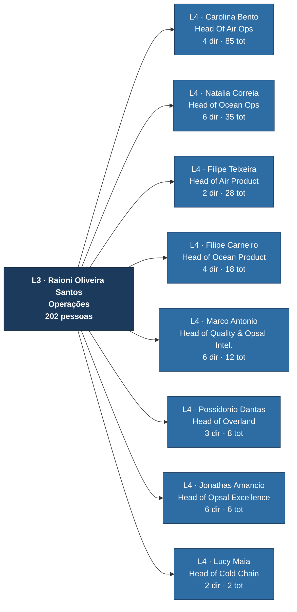

**Ramo: Head Of Air Operations — Carolina Bento Mendoza** (85 pessoas)

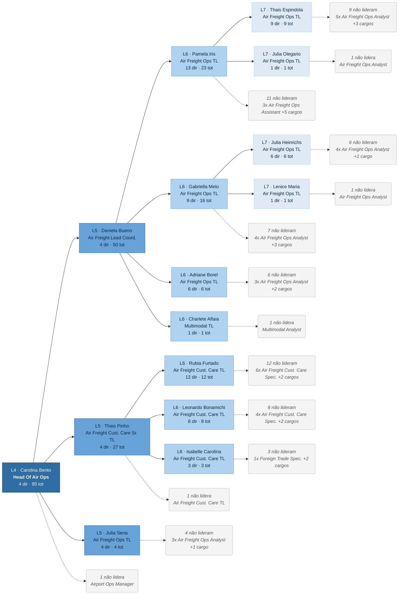

**Ramo: Head of Ocean Operations — Natalia Correia Da Costa Parreira** (35 pessoas)

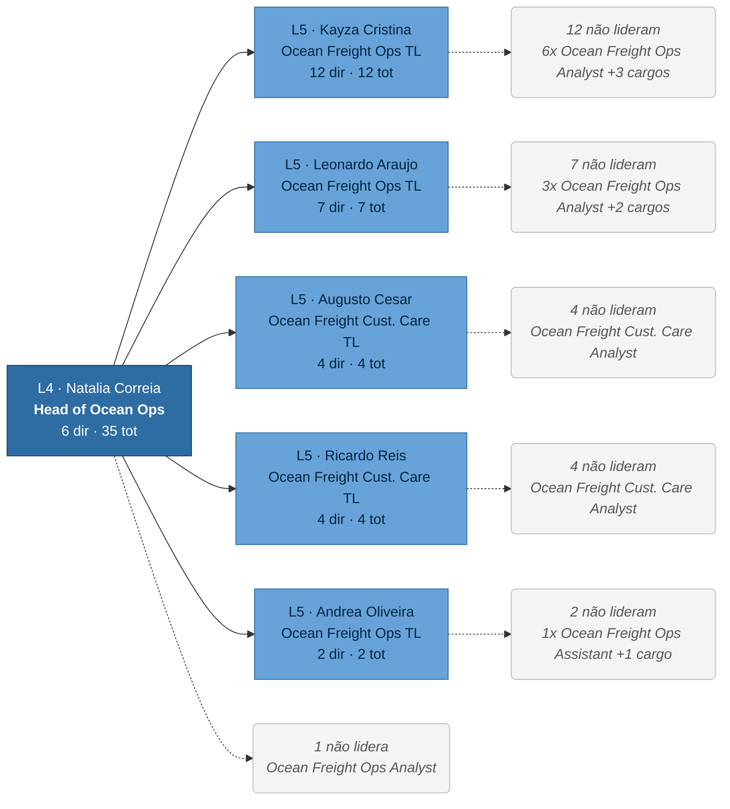

**Ramo: Head of Air Product — Filipe Teixeira Sampaio** (28 pessoas)

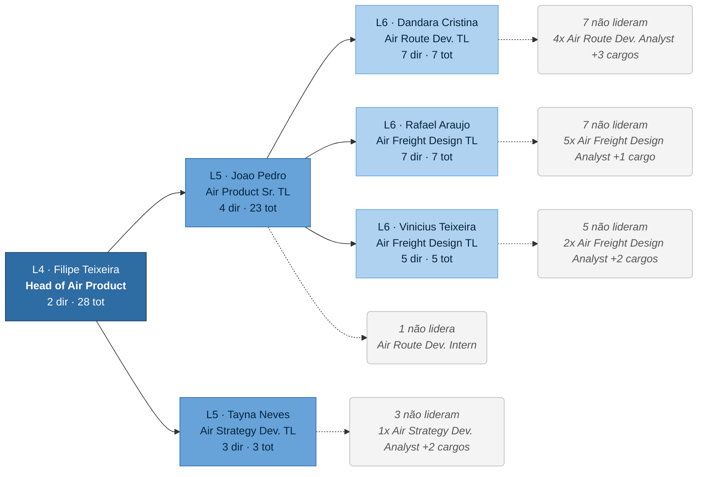

**Ramo: Head of Ocean Product — Filipe Carneiro De Oliveira** (18 pessoas)

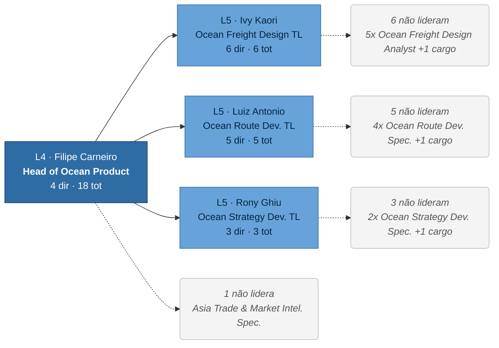

**Ramo: Head of Quality & Operational Intelligence — Marco Antonio Maraia Villa** (12 pessoas)

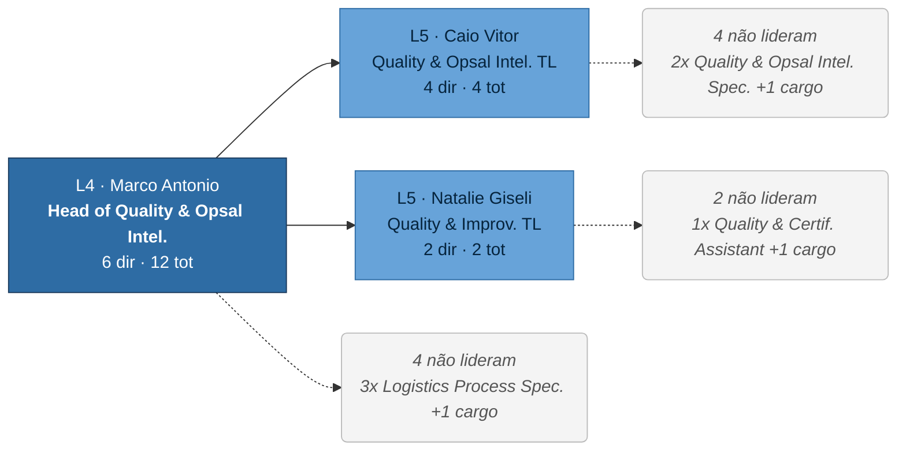

**Ramo: Head of Overland — Possidonio Dantas de Almeida Neto** (8 pessoas)

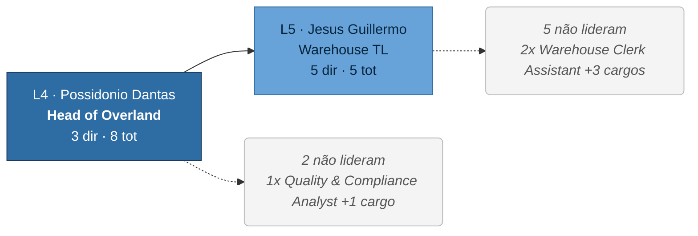


<details><summary>Árvore em texto (clique para abrir)</summary>

**L3 Raioni De Oliveira Santos** — Operações

+-- **L4 Carolina Bento Mendoza** · Head Of Air Ops `4 diretos / 85 total`  
    +-- **L5 Daniela Bueno dos Reis Craig** · Air Freight Lead Coord. `4 diretos / 50 total`  
        +-- **L6 Pamela Iris Gregorio Ibarra** · Air Freight Ops TL `13 diretos / 23 total`  
            +-- **L7 Thais Espindola Oliveira Mathias** · Air Freight Ops TL `9 diretos / 9 total`  
                +-- _9 pessoas que não lideram_ — Air Freight Ops Analyst (5), Air Freight Ops Assistant (2), Air Freight Ops Intern, cargo em branco  
            +-- **L7 Julia Olegario Varella** · Air Freight Ops TL `1 direto / 1 total`  
                +-- _1 pessoa que não lidera_ — Air Freight Ops Analyst  
            +-- _11 pessoas que não lideram_ — Air Freight Ops Assistant (3), Air Freight Ops Spec. (2), Air Freight Ops Analyst (2), Air Freight Ops Intern (2), cargo em branco, Speditionskaufmann Analytiker  
        +-- **L6 Gabriella De Melo Pereira** · Air Freight Ops TL `9 diretos / 16 total`  
            +-- **L7 Julia Heinrichs Pimentel** · Air Freight Ops TL `6 diretos / 6 total`  
                +-- _6 pessoas que não lideram_ — Air Freight Ops Analyst (4), Air Freight Ops Assistant (2)  
            +-- **L7 Lenice Maria da Costa Barbosa** · Air Freight Ops TL `1 direto / 1 total`  
                +-- _1 pessoa que não lidera_ — Air Freight Ops Analyst  
            +-- _7 pessoas que não lideram_ — Air Freight Ops Analyst (4), Ops Agent, Air Freight Ops Assistant, Air Freight Ops Spec.  
        +-- **L6 Adriane Borel Cordeiro Impagliazzo** · Air Freight Ops TL `6 diretos / 6 total`  
            +-- _6 pessoas que não lideram_ — Air Freight Ops Analyst (3), Air Freight Ops Intern (2), cargo em branco  
        +-- **L6 Charlete Alfaia Guimaraes Santana** · Multimodal TL `1 direto / 1 total`  
            +-- _1 pessoa que não lidera_ — Multimodal Analyst  
    +-- **L5 Thais Pinho Cosenza** · Air Freight Cust. Care Sr. TL `4 diretos / 27 total`  
        +-- **L6 Rubia Furtado** · Air Freight Cust. Care TL `12 diretos / 12 total`  
            +-- _12 pessoas que não lideram_ — Air Freight Cust. Care Spec. (6), Air Freight Cust. Care Analyst (4), Air Freight Cust. Care Intern (2)  
        +-- **L6 Leonardo Bonamichi Vaz de Lima** · Air Freight Cust. Care TL `8 diretos / 8 total`  
            +-- _8 pessoas que não lideram_ — Air Freight Cust. Care Spec. (4), Air Freight Cust. Care Analyst (3), Logistics Control Tower Spec.  
        +-- **L6 Isabelle Carolina De Melo Martinez Lizama** · Air Freight Cust. Care TL `3 diretos / 3 total`  
            +-- _3 pessoas que não lideram_ — Foreign Trade Spec., Air Freight Cust. Care Spec., Air Freight Cust. Care Analyst  
        +-- _1 pessoa que não lidera_ — Air Freight Cust. Care TL  
    +-- **L5 Julia Sena Campelo Lopes** · Air Freight Ops TL `4 diretos / 4 total`  
        +-- _4 pessoas que não lideram_ — Air Freight Ops Analyst (3), Air Freight Ops Intern  
    +-- _1 pessoa que não lidera_ — Airport Ops Manager  
+-- **L4 Natalia Correia Da Costa Parreira** · Head of Ocean Ops `6 diretos / 35 total`  
    +-- **L5 Kayza Cristina Silva Pereira** · Ocean Freight Ops TL `12 diretos / 12 total`  
        +-- _12 pessoas que não lideram_ — Ocean Freight Ops Analyst (6), Ocean Freight Ops Intern (4), Ocean Freight Ops Assistant, Ocean Freight Ops Spec.  
    +-- **L5 Leonardo Araujo de Menezes** · Ocean Freight Ops TL `7 diretos / 7 total`  
        +-- _7 pessoas que não lideram_ — Ocean Freight Ops Analyst (3), Ocean Freight Ops Assistant (3), Ocean Freight Ops Intern  
    +-- **L5 Augusto Cesar Sotelo Medeiros** · Ocean Freight Cust. Care TL `4 diretos / 4 total`  
        +-- _4 pessoas que não lideram_ — Ocean Freight Cust. Care Analyst (4)  
    +-- **L5 Ricardo Dos Reis Castro** · Ocean Freight Cust. Care TL `4 diretos / 4 total`  
        +-- _4 pessoas que não lideram_ — Ocean Freight Cust. Care Analyst (4)  
    +-- **L5 Andrea Oliveira Brito Do Couto** · Ocean Freight Ops TL `2 diretos / 2 total`  
        +-- _2 pessoas que não lideram_ — Ocean Freight Ops Assistant, Ocean Freight Ops Intern  
    +-- _1 pessoa que não lidera_ — Ocean Freight Ops Analyst  
+-- **L4 Filipe Teixeira Sampaio** · Head of Air Product `2 diretos / 28 total`  
    +-- **L5 Joao Pedro Da Costa Marcicano Rodrigues** · Air Product Sr. TL `4 diretos / 23 total`  
        +-- **L6 Dandara Cristina Santos Ru** · Air Route Dev. TL `7 diretos / 7 total`  
            +-- _7 pessoas que não lideram_ — Air Route Dev. Analyst (4), Air Route Dev. Assistant, Air Route Dev. Intern, Air Route Dev. Spec.  
        +-- **L6 Rafael Araujo Belfiore** · Air Freight Design TL `7 diretos / 7 total`  
            +-- _7 pessoas que não lideram_ — Air Freight Design Analyst (5), Air Freight Design Spec. (2)  
        +-- **L6 Vinicius Teixeira Studart Pereira** · Air Freight Design TL `5 diretos / 5 total`  
            +-- _5 pessoas que não lideram_ — Air Freight Design Analyst (2), Air Freight Design Spec. (2), Project Ops Spec.  
        +-- _1 pessoa que não lidera_ — Air Route Dev. Intern  
    +-- **L5 Tayna Neves** · Air Strategy Dev. TL `3 diretos / 3 total`  
        +-- _3 pessoas que não lideram_ — Air Strategy Dev. Analyst, Air Strategy Dev. Spec., Air Strategy Dev. Executive  
+-- **L4 Filipe Carneiro De Oliveira** · Head of Ocean Product `4 diretos / 18 total`  
    +-- **L5 Ivy Kaori Oishi** · Ocean Freight Design TL `6 diretos / 6 total`  
        +-- _6 pessoas que não lideram_ — Ocean Freight Design Analyst (5), Ocean Freight Design Assistant  
    +-- **L5 Luiz Antonio Duarte Ferreira Junior** · Ocean Route Dev. TL `5 diretos / 5 total`  
        +-- _5 pessoas que não lideram_ — Ocean Route Dev. Spec. (4), Terminals &amp; Contract Logistics Spec.  
    +-- **L5 Rony Ghiu De Moraes Rego Da Silva** · Ocean Strategy Dev. TL `3 diretos / 3 total`  
        +-- _3 pessoas que não lideram_ — Ocean Strategy Dev. Spec. (2), Ocean Tender Strategy Spec.  
    +-- _1 pessoa que não lidera_ — Asia Trade &amp; Market Intel. Spec.  
+-- **L4 Marco Antonio Maraia Villa** · Head of Quality &amp; Opsal Intel. `6 diretos / 12 total`  
    +-- **L5 Caio Vitor de Carvalho Santos** · Quality &amp; Opsal Intel. TL `4 diretos / 4 total`  
        +-- _4 pessoas que não lideram_ — Quality &amp; Opsal Intel. Spec. (2), Quality &amp; Opsal Intel. Analyst (2)  
    +-- **L5 Natalie Giseli De Maria Correa** · Quality &amp; Improv. TL `2 diretos / 2 total`  
        +-- _2 pessoas que não lideram_ — Quality &amp; Certif. Assistant, Quality Improv. Assistant  
    +-- _4 pessoas que não lideram_ — Logistics Process Spec. (3), Quality &amp; Compliance Analyst  
+-- **L4 Possidonio Dantas de Almeida Neto** · Head of Overland `3 diretos / 8 total`  
    +-- **L5 Jesus Guillermo Ledi Mendoza** · Warehouse TL `5 diretos / 5 total`  
        +-- _5 pessoas que não lideram_ — Warehouse Clerk Assistant (2), Warehouse Clerk Analyst, Warehouse Clerk, Ops Agent  
    +-- _2 pessoas que não lideram_ — Quality &amp; Compliance Analyst, Warehouse TL  
+-- **L4 Jonathas Amancio Alves** · Head of Opsal Excellence `6 diretos / 6 total`  
    +-- _6 pessoas que não lideram_ — Key Account Executive (5), Opsal Excellence &amp; Capacity Spec.  
+-- **L4 Lucy Maia De Moraes** · Head of Cold Chain `2 diretos / 2 total`  
    +-- _2 pessoas que não lideram_ — Pharma &amp; Cold Chain Spec., Air Strategy Dev. Spec.  

</details>

### Tecnologia — Cleyton Cardoso Esteves

`L3` · 2 liderados diretos · **47 pessoas na área** · 4 gestores abaixo

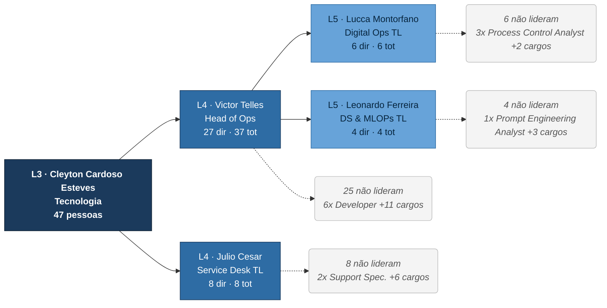

<details><summary>Árvore em texto (clique para abrir)</summary>

**L3 Cleyton Cardoso Esteves** — Tecnologia

+-- **L4 Victor Telles Gonzaga** · Head of Ops `27 diretos / 37 total`  
    +-- **L5 Lucca Montorfano Cruz Santos** · Digital Ops TL `6 diretos / 6 total`  
        +-- _6 pessoas que não lideram_ — Process Control Analyst (3), Process Control Assistant (2), Process Control Spec.  
    +-- **L5 Leonardo Ferreira Sabbadim** · DS &amp; MLOPs TL `4 diretos / 4 total`  
        +-- _4 pessoas que não lideram_ — Prompt Engineering Analyst, Data &amp; AI Spec., Dev. Assistant, Product Design Assistant  
    +-- _25 pessoas que não lideram_ — Developer (6), Dev. Assistant (4), Software Dev. Intern (3), Data Assistant (2), Dev. Analyst (2), Data Analyst (2), Platform Architecture Spec., Implementation Spec., Data Science Intern, Software Dev. Assistant, Quality Enablement Assistant, Product Design Analyst  
+-- **L4 Julio Cesar Francisco de Souza** · Service Desk TL `8 diretos / 8 total`  
    +-- _8 pessoas que não lideram_ — Support Spec. (2), Data Engineering Assistant, Data Engineering Analyst, Service Desk Analyst, Support Assistant, Service Desk Spec., Service Desk Intern  

</details>

### Finanças — Ana Carolina Botelho Caldeira Vasconcellos

`L3` · 7 liderados diretos · **33 pessoas na área** · 5 gestores abaixo

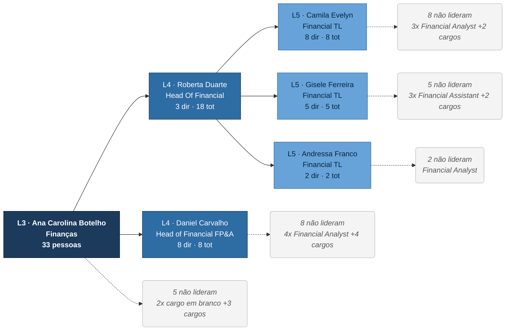

<details><summary>Árvore em texto (clique para abrir)</summary>

**L3 Ana Carolina Botelho Caldeira Vasconcellos** — Finanças

+-- **L4 Roberta Duarte Correia** · Head Of Financial `3 diretos / 18 total`  
    +-- **L5 Camila Evelyn De Souza Lima** · Financial TL `8 diretos / 8 total`  
        +-- _8 pessoas que não lideram_ — Financial Analyst (3), Financial Assistant (3), Financial Intern (2)  
    +-- **L5 Gisele Ferreira Pinto** · Financial TL `5 diretos / 5 total`  
        +-- _5 pessoas que não lideram_ — Financial Assistant (3), Financial Young Apprentice, Financial Analyst  
    +-- **L5 Andressa Franco Da Silva** · Financial TL `2 diretos / 2 total`  
        +-- _2 pessoas que não lideram_ — Financial Analyst (2)  
+-- **L4 Daniel de Carvalho Herrera Braga** · Head of Financial FP&amp;A `8 diretos / 8 total`  
    +-- _8 pessoas que não lideram_ — Financial Analyst (4), Financial FP&amp;A Analyst, Performance Mgmt Analyst, Financial Spec., Financial Assistant  
+-- _5 pessoas que não lideram_ — cargo em branco (2), Procurement Analyst, BI &amp; Data Science TL, Head Of Revenue Mgmt  

</details>

### Recursos Humanos — Carolina Karnakis de Nobrega

`L3` · 6 liderados diretos · **24 pessoas na área** · 5 gestores abaixo

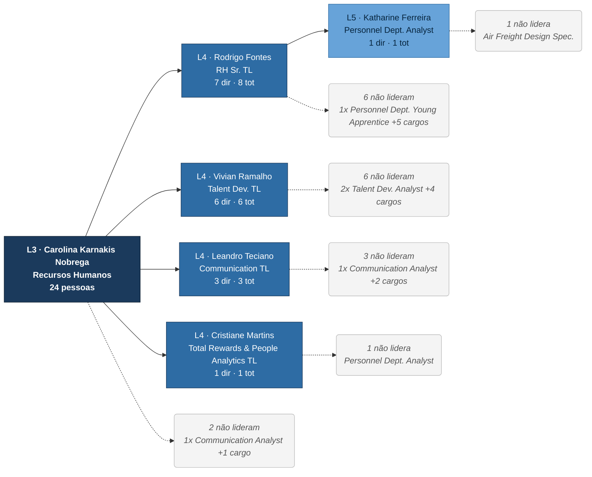

<details><summary>Árvore em texto (clique para abrir)</summary>

**L3 Carolina Karnakis de Nobrega** — Recursos Humanos

+-- **L4 Rodrigo Fontes Dominciano** · RH Sr. TL `7 diretos / 8 total`  
    +-- **L5 Katharine Ferreira De Souza** · Personnel Dept. Analyst `1 direto / 1 total`  
        +-- _1 pessoa que não lidera_ — Air Freight Design Spec.  
    +-- _6 pessoas que não lideram_ — Personnel Dept. Young Apprentice, Talent Acquisition Analyst, Consultor, Geral, Facilities Intern, Facilites Analyst, International RH Analyst  
+-- **L4 Vivian Ramalho De Assumpçao** · Talent Dev. TL `6 diretos / 6 total`  
    +-- _6 pessoas que não lideram_ — Talent Dev. Analyst (2), cargo em branco, Talent Acquisition Analyst, Data Analysis Young Apprentice, Talent Acquisition Intern  
+-- **L4 Leandro Teciano** · Communication TL `3 diretos / 3 total`  
    +-- _3 pessoas que não lideram_ — Communication Analyst, Social Media &amp; Design Analyst, Communication Intern  
+-- **L4 Cristiane Martins Soares Giovanelli** · Total Rewards &amp; People Analytics TL `1 direto / 1 total`  
    +-- _1 pessoa que não lidera_ — Personnel Dept. Analyst  
+-- _2 pessoas que não lideram_ — Communication Analyst, cargo em branco  

</details>

### Comercial / Indústrias — Andre Lemos Tavares

`L3` · 5 liderados diretos · **18 pessoas na área** · 7 gestores abaixo

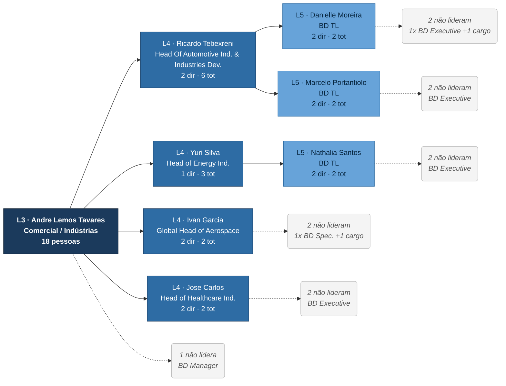

<details><summary>Árvore em texto (clique para abrir)</summary>

**L3 Andre Lemos Tavares** — Comercial / Indústrias

+-- **L4 Ricardo Tebexreni Jakowatz** · Head Of Automotive Ind. &amp; Industries Dev. `2 diretos / 6 total`  
    +-- **L5 Danielle Moreira Rabelo Machado** · BD TL `2 diretos / 2 total`  
        +-- _2 pessoas que não lideram_ — BD Executive, cargo em branco  
    +-- **L5 Marcelo Portantiolo de Lima** · BD TL `2 diretos / 2 total`  
        +-- _2 pessoas que não lideram_ — BD Executive (2)  
+-- **L4 Yuri Da Silva Torreao** · Head of Energy Ind. `1 direto / 3 total`  
    +-- **L5 Nathalia Santos Reis Cordeiro** · BD TL `2 diretos / 2 total`  
        +-- _2 pessoas que não lideram_ — BD Executive (2)  
+-- **L4 Ivan Garcia Castro** · Global Head of Aerospace `2 diretos / 2 total`  
    +-- _2 pessoas que não lideram_ — BD Spec., BD Executive  
+-- **L4 Jose Carlos Duarte Freitas Sobrinho** · Head of Healthcare Ind. `2 diretos / 2 total`  
    +-- _2 pessoas que não lideram_ — BD Executive (2)  
+-- _1 pessoa que não lidera_ — BD Manager  

</details>

### Serviços / Diligenciamento — Luis Fernando Santos Muniz

`L3` · 5 liderados diretos · **5 pessoas na área** · 0 gestores abaixo

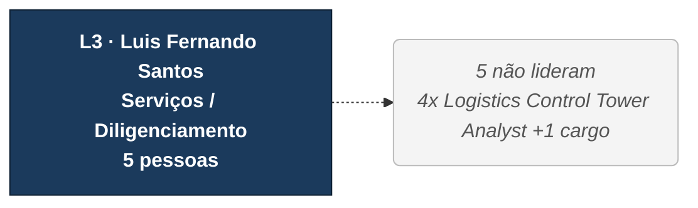

<details><summary>Árvore em texto (clique para abrir)</summary>

**L3 Luis Fernando Santos Muniz** — Serviços / Diligenciamento

+-- _5 pessoas que não lideram_ — Logistics Control Tower Analyst (4), Air Freight Cust. Care Analyst  

</details>

---

## 4. Os 66 gestores, do maior para o menor time

| Nível | Nome | Cargo | Diretos | Total abaixo | Diretoria |
|---|---|---|---|---|---|
| L2 | Jose Luiz de Oliveira Belixior Junior | — (CEO) | 6 | 335 | DMS |
| L3 | Raioni De Oliveira Santos | — | 8 | 202 | Operações |
| L3 | Cleyton Cardoso Esteves | — | 2 | 47 | Tecnologia |
| L3 | Ana Carolina Botelho Caldeira Vasconcellos | — | 7 | 33 | Finanças |
| L3 | Carolina Karnakis de Nobrega | — | 6 | 24 | Recursos Humanos |
| L3 | Andre Lemos Tavares | — | 5 | 18 | Comercial / Indústrias |
| L3 | Luis Fernando Santos Muniz | — | 5 | 5 | Serviços / Diligenciamento |
| L4 | Carolina Bento Mendoza | Head Of Air Operations | 4 | 85 | Operações |
| L5 | Daniela Bueno dos Reis Craig | Air Freight Lead Coordinator | 4 | 50 | Operações |
| L4 | Victor Telles Gonzaga | Head of Operation | 27 | 37 | Tecnologia |
| L4 | Natalia Correia Da Costa Parreira | Head of Ocean Operations | 6 | 35 | Operações |
| L4 | Filipe Teixeira Sampaio | Head of Air Product | 2 | 28 | Operações |
| L5 | Thais Pinho Cosenza | Air Freight Customer Care Senior Team Leader | 4 | 27 | Operações |
| L5 | Joao Pedro Da Costa Marcicano Rodrigues | Air Product Senior Team Leader | 4 | 23 | Operações |
| L6 | Pamela Iris Gregorio Ibarra | Air Freight Operations Team Leader | 13 | 23 | Operações |
| L4 | Roberta Duarte Correia | Head Of Financial | 3 | 18 | Finanças |
| L4 | Filipe Carneiro De Oliveira | Head of Ocean Product | 4 | 18 | Operações |
| L6 | Gabriella De Melo Pereira | Air Freight Operations Team Leader | 9 | 16 | Operações |
| L4 | Marco Antonio Maraia Villa | Head of Quality & Operational Intelligence | 6 | 12 | Operações |
| L5 | Kayza Cristina Silva Pereira | Ocean Freight Operations Team Leader | 12 | 12 | Operações |
| L6 | Rubia Furtado | Air Freight Customer Care Team Leader | 12 | 12 | Operações |
| L7 | Thais Espindola Oliveira Mathias | Air Freight Operations Team Leader | 9 | 9 | Operações |
| L4 | Julio Cesar Francisco de Souza | Service Desk Team Leader | 8 | 8 | Tecnologia |
| L4 | Daniel de Carvalho Herrera Braga | Head of Financial Planning & Analysis | 8 | 8 | Finanças |
| L4 | Possidonio Dantas de Almeida Neto | Head of Overland | 3 | 8 | Operações |
| L4 | Rodrigo Fontes Dominciano | Human Resources Sr. Team Leader | 7 | 8 | Recursos Humanos |
| L5 | Camila Evelyn De Souza Lima | Financial Team Leader | 8 | 8 | Finanças |
| L6 | Leonardo Bonamichi Vaz de Lima | Air Freight Customer Care Team Leader | 8 | 8 | Operações |
| L5 | Leonardo Araujo de Menezes | Ocean Freight Operations Team Leader | 7 | 7 | Operações |
| L6 | Dandara Cristina Santos Ru | Air Route Development Team Leader | 7 | 7 | Operações |
| L6 | Rafael Araujo Belfiore | Air Freight Design Team Leader | 7 | 7 | Operações |
| L4 | Ricardo Tebexreni Jakowatz | Head Of Automotive Industry & Industries Development | 2 | 6 | Comercial / Indústrias |
| L4 | Jonathas Amancio Alves | Head of Operational Excellence | 6 | 6 | Operações |
| L4 | Vivian Ramalho De Assumpçao | Talent Development Team Leader | 6 | 6 | Recursos Humanos |
| L5 | Lucca Montorfano Cruz Santos | Digital Operations Team Leader | 6 | 6 | Tecnologia |
| L5 | Ivy Kaori Oishi | Ocean Freight Design Team Leader | 6 | 6 | Operações |
| L6 | Adriane Borel Cordeiro Impagliazzo | Air Freight Operations Team Leader | 6 | 6 | Operações |
| L7 | Julia Heinrichs Pimentel | Air Freight Operations Team Leader | 6 | 6 | Operações |
| L5 | Gisele Ferreira Pinto | Financial Team Leader | 5 | 5 | Finanças |
| L5 | Luiz Antonio Duarte Ferreira Junior | Ocean Route Development Team Leader | 5 | 5 | Operações |
| L5 | Jesus Guillermo Ledi Mendoza | Warehouse Team Leader | 5 | 5 | Operações |
| L6 | Vinicius Teixeira Studart Pereira | Air Freight Design Team Leader | 5 | 5 | Operações |
| L5 | Leonardo Ferreira Sabbadim | DS & MLOPs Team Leader | 4 | 4 | Tecnologia |
| L5 | Julia Sena Campelo Lopes | Air Freight Operations Team Leader | 4 | 4 | Operações |
| L5 | Augusto Cesar Sotelo Medeiros | Ocean Freight Customer Care Team Leader | 4 | 4 | Operações |
| L5 | Ricardo Dos Reis Castro | Ocean Freight Customer Care Team Leader | 4 | 4 | Operações |
| L5 | Caio Vitor de Carvalho Santos | Quality & Operational Intelligence Team Leader | 4 | 4 | Operações |
| L4 | Yuri Da Silva Torreao | Head of Energy Industry | 1 | 3 | Comercial / Indústrias |
| L4 | Leandro Teciano | Communication Team Leader | 3 | 3 | Recursos Humanos |
| L5 | Rony Ghiu De Moraes Rego Da Silva | Ocean Strategy Development Team Leader | 3 | 3 | Operações |
| L5 | Tayna Neves | Air Strategy Development Team Leader | 3 | 3 | Operações |
| L6 | Isabelle Carolina De Melo Martinez Lizama | Air Freight Customer Care Team Leader | 3 | 3 | Operações |
| L4 | Ivan Garcia Castro | Global Head of Aerospace | 2 | 2 | Comercial / Indústrias |
| L4 | Jose Carlos Duarte Freitas Sobrinho | Head of Healthcare Industry | 2 | 2 | Comercial / Indústrias |
| L4 | Lucy Maia De Moraes | Head of Cold Chain | 2 | 2 | Operações |
| L5 | Nathalia Santos Reis Cordeiro | Business Development Team Leader | 2 | 2 | Comercial / Indústrias |
| L5 | Danielle Moreira Rabelo Machado | Business Development Team Leader | 2 | 2 | Comercial / Indústrias |
| L5 | Marcelo Portantiolo de Lima | Business Development Team Leader | 2 | 2 | Comercial / Indústrias |
| L5 | Andressa Franco Da Silva | Financial Team Leader | 2 | 2 | Finanças |
| L5 | Andrea Oliveira Brito Do Couto | Ocean Freight Operations Team Leader | 2 | 2 | Operações |
| L5 | Natalie Giseli De Maria Correa | Quality & Improvement Team Leader | 2 | 2 | Operações |
| L4 | Cristiane Martins Soares Giovanelli | Total Rewards & People Analytics Team Leader | 1 | 1 | Recursos Humanos |
| L5 | Katharine Ferreira De Souza | Personnel Department Analyst | 1 | 1 | Recursos Humanos |
| L6 | Charlete Alfaia Guimaraes Santana | Multimodal Team Leader | 1 | 1 | Operações |
| L7 | Lenice Maria da Costa Barbosa | Air Freight Operations Team Leader | 1 | 1 | Operações |
| L7 | Julia Olegario Varella | Air Freight Operations Team Leader | 1 | 1 | Operações |

---

## 5. Composição por faixa de cargo

| Faixa | L4 | L5 | L6 | L7 | L8 | Total |
|---|---|---|---|---|---|---|
| Head / Manager | 17 | 1 | 0 | 0 | 0 | **18** |
| Team Leader | 6 | 25 | 11 | 4 | 0 | **46** |
| Executive (comercial) | 0 | 8 | 6 | 0 | 0 | **14** |
| Specialist | 0 | 15 | 15 | 22 | 0 | **52** |
| Analyst | 7 | 33 | 39 | 30 | 11 | **120** |
| Assistant | 0 | 10 | 22 | 6 | 4 | **42** |
| Intern / Aprendiz | 0 | 10 | 11 | 7 | 1 | **29** |
| Cargo em branco | 3 | 1 | 1 | 2 | 1 | **8** |
| **Total** | 33 | 103 | 105 | 71 | 17 | **329** |

---

## 6. O que salta aos olhos

1. **Operações concentra 60% da empresa** — 202 das 335 pessoas abaixo do CEO, contra 47 em Tecnologia e 33 em Finanças. É a única diretoria que desce até o L8.
2. **Sete níveis do CEO ao analista mais fundo, dentro de Operações Aéreo.** A cadeia é `CEO → Raioni → Carolina Mendoza → Daniela Craig → Pamela Ibarra → Thais Mathias → analista (L8)`: seis gestores empilhados sobre uma pessoa. Três delas (Pamela L6, Gabriella L6, Thais L7) carregam o **mesmo título** — *Air Freight Operations Team Leader* — e lideram umas às outras, o que indica que a senioridade real não está refletida no cargo.
3. **Um gestor com 27 liderados diretos:** Victor Telles Gonzaga (*Head of Operation*) — 37 no total, contra uma média de 5,0 entre os gestores L4–L7. O cargo dele é *Head of Operation*, mas o time é todo de tecnologia (Developers, Data, Product Design) e ele reporta ao Cleyton — o título provavelmente está desatualizado na base.
4. **6 gestores com um único liderado** — Yuri Da Silva Torreao (L4, Head of Energy Industry); Cristiane Martins Soares Giovanelli (L4, Total Rewards & People Analytics Team Leader); Katharine Ferreira De Souza (L5, Personnel Department Analyst); Charlete Alfaia Guimaraes Santana (L6, Multimodal Team Leader); Lenice Maria da Costa Barbosa (L7, Air Freight Operations Team Leader); Julia Olegario Varella (L7, Air Freight Operations Team Leader). São camadas de gestão que custam um nível inteiro para coordenar uma pessoa.
5. **Serviços / Diligenciamento (Luis Fernando) não tem nenhuma camada intermediária:** 5 analistas reportando direto ao L3, e nenhum deles lidera ninguém. É a área que o draft trata na seção *Serviços (Diligenciamento)*.
6. **8 cargos em branco na planilha** — todas com data de início entre 2026-09-01 e 2026-11-16. 5 delas têm data de início **no futuro**, ou seja, são admissões ainda por entrar, e as outras 3 entraram em setembro sem função cadastrada:

| Nível | Nome | Gestor | Início | Local |
|---|---|---|---|---|
| L4 | Isabella Stodiek | Ana Carolina Botelho Caldeira Vasconcellos | 2026-09-01 | DMS Alemanha |
| L4 | Piraci Ubiratan de Oliveira Junior | Ana Carolina Botelho Caldeira Vasconcellos | 2026-09-01 | DMS SP - 0003-20 |
| L4 | Fernanda Máximo de Souza Fonseca | Carolina Karnakis de Nobrega | 2026-09-01 | DMS SP - 0003-20 |
| L5 | Danielle Vaz Faustino | Vivian Ramalho De Assumpçao | 2026-11-03 | DMS SP - 0008-35 |
| L6 | Thalita Carnevale Sodre | Danielle Moreira Rabelo Machado | 2026-11-03 | DMS RJ - 0001-69 |
| L7 | Isabelle Oliveira Rattes | Adriane Borel Cordeiro Impagliazzo | 2026-11-03 | DMS RJ - 0001-69 |
| L7 | Fernanda Porto Lima | Pamela Iris Gregorio Ibarra | 2026-11-16 | DMS RJ - 0001-69 |
| L8 | Poliana de Jesus Guedes | Thais Espindola Oliveira Mathias | 2026-11-03 | DMS RJ - 0001-69 |

7. **Título e função não batem em 7 casos.** 6 pessoas têm título de chefia e **nenhum liderado**: Maria Salete Verly (L4, Business Development Manager); Pedro Henrique Moreira Tostes (L4, Business Intelligence & Data Science Team Leader); Renata Duarte Correia Venturine (L4, Head Of Revenue Management); Magno Bezerra Rocha (L5, Airport Operations Manager); Tiago da Silva e Fontoura (L5, Warehouse Team Leader); Nathalia Regina Dos Santos Carvalho (L6, Air Freight Customer Care Team Leader). Na direção oposta, 1: Katharine Ferreira De Souza (L5, Personnel Department Analyst, 1 liderado). Esse último caso é duplamente estranho: ela é de RH e o único liderado dela tem cargo de *Air Freight Design Specialist* — provavelmente um reporte mal cadastrado.
8. **Produtos aparecem dentro de Operações, não como diretoria.** *Head of Air Product* (Filipe Teixeira Sampaio, 28 pessoas) e *Head of Ocean Product* (Filipe Carneiro De Oliveira, 18) reportam ao Raioni. No draft, `Prod Aéreo | Sampaio` e `Prod Marítimo | Filipe` abrem como blocos próprios — vale alinhar se é a visão atual ou a visão desejada.

---

## 7. Onde a planilha e o draft divergem

O `Draft 23 Out 26.pptx` tem 75 slides, mas os organogramas estão **como imagem** — não há texto extraível para comparar nome a nome. O que dá para cruzar são os títulos de seção e os bilhetes deixados nos slides:

| Seção do draft | Equivalente na planilha | Observação do próprio draft |
|---|---|---|
| Produto Aéreo / Produto Marítimo (sl. 2–15) | L4 dentro de Operações | *"A estrutura é separada por região — EUA / EUROPA / ÁSIA. Precisamos fazer essa abertura"* |
| Indústria (sl. 16–21) | Comercial / Indústrias (André Lemos) | Aerospace, Energy, Automotivo, Healthcare batem com os 4 *Heads of Industry*; slide 20 marca **vaga de TL** |
| Tecnologia (sl. 23–26) | Tecnologia (Cleyton) | *"A estrutura foi ajustada recentemente — temos que pegar a visão atualizada"* |
| Finanças (sl. 28–34) | Finanças (Ana Carolina) | mesma ressalva de visão desatualizada |
| RH (sl. 36–40) | Recursos Humanos (Karnakis) | mesma ressalva |
| Serviços / Diligenciamento (sl. 42) | Luis Fernando (5 analistas) | — |
| Operações (sl. 45–75) | Operações (Raioni) | mesma ressalva; inclui Exportação, Customer Care, Marítimo, Aéreo EUA/MIA, Inteligência e Excelência Operacional, KAM e Capacity |

Quatro das seis diretorias trazem o aviso de que **o organograma do draft está desatualizado em relação à estrutura real**. A planilha Factorial é a visão mais recente, e é ela que este documento reconstrói.

---

## Como regerar

```bash
pip install openpyxl
python3 estrutura/gerar_hierarquia.py
```

Gera este arquivo e `estrutura/Hierarquia_DMS.xlsx` (base indentada navegável, lista de gestores e resumo).
